# FuckCaptcha 

<picture>
  <source media="(prefers-color-scheme: light)" srcset="assets/brand/readme-banner-light.png">
  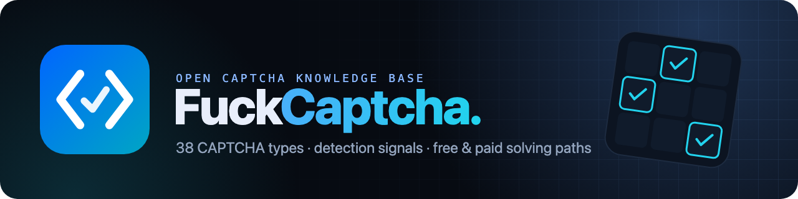
</picture>

**FuckCaptcha** is an open reference for understanding CAPTCHA types, their context and the approaches documented around them. It is intended for education and authorized research, not for evading protections on services without permission.

**[Browse the interactive field guide →](https://vsmutok.github.io/FuckCaptcha/)**

## Contents

- [Project Goal](#project-goal)
- [How to Use the Guide](#how-to-use-the-guide)
- [CAPTCHA Identification](#captcha-identification)
- [Difficulty Scale](#difficulty-scale)
- [Project Structure](#project-structure)
- [Useful Links](#useful-links)

---
## Project Goal

Bring a changing landscape of CAPTCHA systems into one approachable, maintained reference. The project aims to make the material easier to navigate, compare and cite while keeping responsible, authorized use explicit.

## How to Use the Guide

1. Browse or search the library for the CAPTCHA type you want to understand.
2. Read its overview and compare the documented approaches, references and limitations.
3. Keep testing within an environment where you have permission, and respect applicable terms and privacy.

The project brings together a practical, maintainable reference for researchers, developers and curious readers: **identify** common CAPTCHA families and their context, **compare** documented tools and approaches with their trade-offs, and **stay responsible** by prioritizing authorized research, privacy and transparent sourcing.

## CAPTCHA Identification

Choose a CAPTCHA below to open its guide, review the challenge category and see the references and options documented for it.

|                                                                                            |                                                                                                |                                                                                                  |                                                                                                    |                                                                                          |
| ------------------------------------------------------------------------------------------ | ---------------------------------------------------------------------------------------------- | ------------------------------------------------------------------------------------------------ | -------------------------------------------------------------------------------------------------- | ---------------------------------------------------------------------------------------- |
| 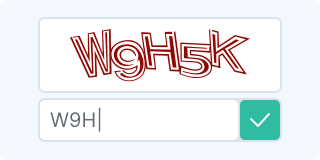         |              |                |  |  |
| [**Text-based**](docs/captchas/normal.md)                                                  | [**reCAPTCHA v2**](docs/captchas/recaptcha.md#1-recaptcha-v2)                                  | [**reCAPTCHA v3**](docs/captchas/recaptcha.md#2-recaptcha-v3)                                    | [**reCAPTCHA Enterprise**](docs/captchas/recaptcha.md#3-recaptcha-enterprise)                      | [**Cloudflare**](docs/captchas/cloudflare.md)                                            |
|                    |                     |                           |                  | 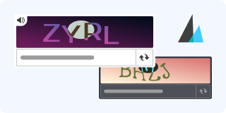             |
| [**GeeTest**](docs/captchas/geetest.md)                                                    | [**Arkose Labs**](docs/captchas/arkose.md)                                                     | [**Amazon WAF**](docs/captchas/aws.md)                                                           | [**DataDome**](docs/captchas/datadome.md)                                                          | [**MTCaptcha**](docs/captchas/mtcaptcha.md)                                              |
|            | 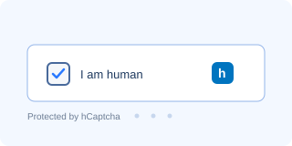                     | 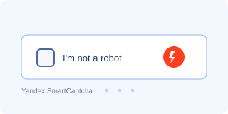 |                       | 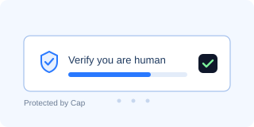                         |
| [**Tencent**](docs/captchas/tencent.md)                                                    | [**hCaptcha**](docs/captchas/hcaptcha.md)                                                      | [**Yandex**](docs/captchas/yandex-smartcaptcha.md)                                               | [**VK**](docs/captchas/vk.md)                                                                      | [**Cap**](docs/captchas/cap.md)                                                          |
|                | 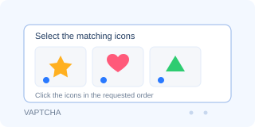                       | 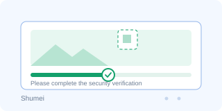                   | 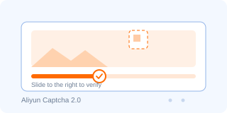                     | 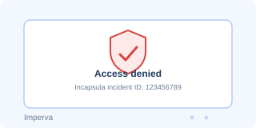                 |
| [**Yidun**](docs/captchas/yidun.md)                                                        | [**VAPTCHA**](docs/captchas/vaptcha.md)                                                        | [**Shumei**](docs/captchas/shumei.md)                                                            | [**Aliyun**](docs/captchas/aliyun.md)                                                              | [**Imperva**](docs/captchas/imperva.md)                                                  |
|                      | 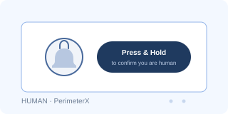                | 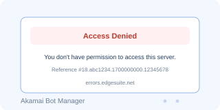               | 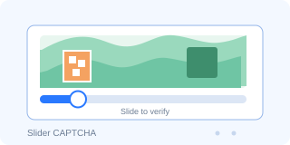                     | 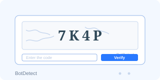             |
| [**Kasada**](docs/captchas/kasada.md)                                                      | [**HUMAN**](docs/captchas/human.md)                                                            | [**Akamai**](docs/captchas/akamai.md)                                                            | [**Slider**](docs/captchas/slider.md)                                                              | [**BotDetect**](docs/captchas/botdetect.md)                                              |
|              | 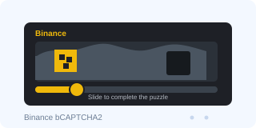               | 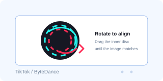                   |                        | 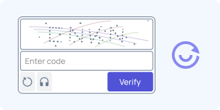           |
| [**Amazon**](docs/captchas/amazon.md)                                                      | [**Binance**](docs/captchas/binance.md)                                                        | [**TikTok**](docs/captchas/tiktok.md)                                                            | [**Audio**](docs/captchas/audio.md)                                                                | [**Altcha**](docs/captchas/altcha.md)                                                    |
|  |                 | 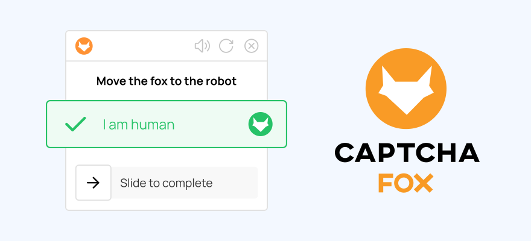                   |                           |            |
| [**Friendly**](docs/captchas/friendly.md)                                                  | [**ATB**](docs/captchas/atbcaptcha.md)                                                         | [**CaptchaFox**](docs/captchas/captchafox.md)                                                    | [**Capy Puzzle**](docs/captchas/capy.md)                                                           | [**CutCaptcha**](docs/captchas/cutcaptcha.md)                                            |
|                        |  | 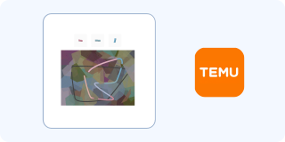               | 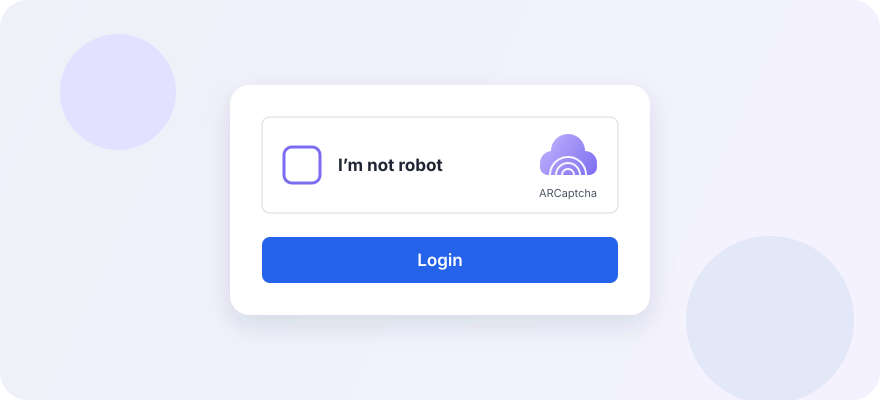                       |                                                                                          |
| [**Lemin**](docs/captchas/lemin.md)                                                        | [**Prosopo**](docs/captchas/prosopo.md)                                                        | [**Temu**](docs/captchas/temu.md)                                                                | [**ARCaptcha**](docs/captchas/arcaptcha.md)                                                        |                                                                                          |

## Need Help?

If you have trouble solving any type of CAPTCHA, feel free to [open an issue](https://github.com/vsmutok/FuckCaptcha/issues) or email me at [vasyl.smutok@gmail.com](mailto:vasyl.smutok@gmail.com), and I will try to help.

## Difficulty Scale

Difficulty labels are editorial estimates for navigating the guide, not guarantees of how a challenge will behave in a particular context.

The five labels are **1 — Low**, **2 — Below average**, **3 — Medium**, **4 — High** and **5 — Very high**.

## Project Structure

The `docs/captchas/` directory contains individual reference pages; `docs/solvers.md` indexes documented tools and services; `docs/resources.md` collects further reading; `assets/images/captchas/` stores catalog illustrations; and `assets/brand/` contains the logo and banner artwork.

## Useful Links
- [Solver and service index](https://github.com/vsmutok/FuckCaptcha/blob/main/docs/solvers.md) - A directory of documented options.
- [Research resources](https://github.com/vsmutok/FuckCaptcha/blob/main/docs/resources.md) - Further reading and references.

### Contributing

Contributions are welcome! Please see [CONTRIBUTING.md](CONTRIBUTING.md) for details.

---
  
### Disclaimer
  
This repository is provided for **educational and authorized research purposes**. Respect applicable law, privacy and the terms of the services you use. The authors are not responsible for misuse of this material.

---

### Star History
  
If this project was useful to you, give it a star! ⭐

---
