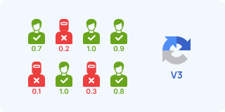

# FuckCaptcha 

<picture>
  <source media="(prefers-color-scheme: light)" srcset="https://raw.githubusercontent.com/vsmutok/FuckCaptcha/main/assets/brand/readme-banner-light.png">
  <source media="(prefers-color-scheme: dark)" srcset="https://raw.githubusercontent.com/vsmutok/FuckCaptcha/main/assets/brand/readme-banner.png">
  
</picture>

 
 

 

**FuckCaptcha** is an open reference for understanding CAPTCHA types, their context and the approaches documented around them. It is intended for education and authorized research, not for evading protections on services without permission.

**[Browse the interactive field guide →](https://vsmutok.github.io/FuckCaptcha/)**

## Contents

- [Project Goal](#project-goal)
- [How to Use the Guide](#how-to-use-the-guide)
- [CAPTCHA Identification](#captcha-identification)
- [Useful Links](#useful-links)
- [Need Help](#need-help)
- [Star History](#star-history)

## Project Goal

CAPTCHAs are one of the main obstacles in web scraping and automation, and the landscape changes constantly. This guide keeps it in one maintained place: how to **identify** each CAPTCHA family, **compare** the documented tools and approaches with their trade-offs, and pick what fits your case, whether that is a solver, a library or avoiding the challenge altogether.

## How to Use the Guide

1. Find the CAPTCHA you are dealing with in the catalog below, or search the interactive library.
2. Read its overview, detection signals, documented approaches and limitations.
3. Choose an approach that fits your project and budget.

## CAPTCHA Identification

Each tile opens its guide. Stars show how hard the CAPTCHA is to deal with, from ★☆☆☆☆ (low) to ★★★★★ (very high). 

Difficulty scale

| Score             | Rating | Meaning                                                                       |
| ----------------- | :----: | ----------------------------------------------------------------------------- |
| 1 — Low           | ★☆☆☆☆  | Straightforward challenge with widely documented, well-understood approaches. |
| 2 — Below average | ★★☆☆☆  | Mostly simple, with a few quirks that require some care.                      |
| 3 — Medium        | ★★★☆☆  | A balanced challenge that combines several techniques or moving parts.        |
| 4 — High          | ★★★★☆  | Complex challenge needing deeper analysis, tooling or tuning.                 |
| 5 — Very high     | ★★★★★  | Advanced, frequently updated or heavily defended; hardest to deal with.       |

<table>
  <tr>
    <td align="center"><a href="docs/captchas/normal.md"> <b>Text-based</b> ★☆☆☆☆</a></td>
    <td align="center"><a href="docs/captchas/recaptcha.md#1-recaptcha-v2"> <b>reCAPTCHA v2</b> ★★★☆☆</a></td>
    <td align="center"><a href="docs/captchas/recaptcha.md#2-recaptcha-v3"> <b>reCAPTCHA v3</b> ★★★★☆</a></td>
    <td align="center"><a href="docs/captchas/recaptcha.md#3-recaptcha-enterprise"> <b>reCAPTCHA Enterprise</b> ★★★★★</a></td>
    <td align="center"><a href="docs/captchas/cloudflare.md"> <b>Cloudflare</b> ★★★☆☆</a></td>
  </tr>
  <tr>
    <td align="center"><a href="docs/captchas/geetest.md"> <b>GeeTest</b> ★★★☆☆</a></td>
    <td align="center"><a href="docs/captchas/arkose.md"> <b>Arkose Labs</b> ★★★★☆</a></td>
    <td align="center"><a href="docs/captchas/aws.md"> <b>Amazon WAF</b> ★★★☆☆</a></td>
    <td align="center"><a href="docs/captchas/datadome.md"> <b>DataDome</b> ★★★★★</a></td>
    <td align="center"><a href="docs/captchas/mtcaptcha.md"> <b>MTCaptcha</b> ★★☆☆☆</a></td>
  </tr>
  <tr>
    <td align="center"><a href="docs/captchas/tencent.md"> <b>Tencent</b> ★★★☆☆</a></td>
    <td align="center"><a href="docs/captchas/hcaptcha.md"> <b>hCaptcha</b> ★★★☆☆</a></td>
    <td align="center"><a href="docs/captchas/yandex-smartcaptcha.md"> <b>Yandex</b> ★★★☆☆</a></td>
    <td align="center"><a href="docs/captchas/vk.md"> <b>VK</b> ★★★★☆</a></td>
    <td align="center"><a href="docs/captchas/cap.md"> <b>Cap</b> ★☆☆☆☆</a></td>
  </tr>
  <tr>
    <td align="center"><a href="docs/captchas/yidun.md"> <b>Yidun</b> ★★★☆☆</a></td>
    <td align="center"><a href="docs/captchas/vaptcha.md"> <b>VAPTCHA</b> ★★★☆☆</a></td>
    <td align="center"><a href="docs/captchas/shumei.md"> <b>Shumei</b> ★★★☆☆</a></td>
    <td align="center"><a href="docs/captchas/aliyun.md"> <b>Aliyun</b> ★★★☆☆</a></td>
    <td align="center"><a href="docs/captchas/imperva.md"> <b>Imperva</b> ★★★★★</a></td>
  </tr>
  <tr>
    <td align="center"><a href="docs/captchas/kasada.md"> <b>Kasada</b> ★★★★★</a></td>
    <td align="center"><a href="docs/captchas/human.md"> <b>HUMAN</b> ★★★★★</a></td>
    <td align="center"><a href="docs/captchas/akamai.md"> <b>Akamai</b> ★★★★★</a></td>
    <td align="center"><a href="docs/captchas/slider.md"> <b>Slider</b> ★★★☆☆</a></td>
    <td align="center"><a href="docs/captchas/botdetect.md"> <b>BotDetect</b> ★☆☆☆☆</a></td>
  </tr>
  <tr>
    <td align="center"><a href="docs/captchas/amazon.md"> <b>Amazon</b> ★☆☆☆☆</a></td>
    <td align="center"><a href="docs/captchas/binance.md"> <b>Binance</b> ★★★★☆</a></td>
    <td align="center"><a href="docs/captchas/tiktok.md"> <b>TikTok</b> ★★★★☆</a></td>
    <td align="center"><a href="docs/captchas/audio.md"> <b>Audio</b> ★★★☆☆</a></td>
    <td align="center"><a href="docs/captchas/altcha.md"> <b>Altcha</b> ★☆☆☆☆</a></td>
  </tr>
  <tr>
    <td align="center"><a href="docs/captchas/friendly.md"> <b>Friendly</b> ★☆☆☆☆</a></td>
    <td align="center"><a href="docs/captchas/atbcaptcha.md"> <b>ATB</b> ★★★☆☆</a></td>
    <td align="center"><a href="docs/captchas/captchafox.md"> <b>CaptchaFox</b> ★★★☆☆</a></td>
    <td align="center"><a href="docs/captchas/capy.md"> <b>Capy Puzzle</b> ★★☆☆☆</a></td>
    <td align="center"><a href="docs/captchas/cutcaptcha.md"> <b>CutCaptcha</b> ★★★☆☆</a></td>
  </tr>
  <tr>
    <td align="center"><a href="docs/captchas/lemin.md"> <b>Lemin</b> ★★★☆☆</a></td>
    <td align="center"><a href="docs/captchas/prosopo.md"> <b>Prosopo</b> ★★★☆☆</a></td>
    <td align="center"><a href="docs/captchas/temu.md"> <b>Temu</b> ★★★★☆</a></td>
    <td align="center"><a href="docs/captchas/arcaptcha.md"> <b>ARCaptcha</b> ★★★☆☆</a></td>
    <td align="center"></td>
  </tr>
</table>

## Useful Links

- [Solver and service index](https://github.com/vsmutok/FuckCaptcha/blob/main/docs/solvers.md) - Open-source projects and services documented in the guide.
- [Research resources](https://github.com/vsmutok/FuckCaptcha/blob/main/docs/resources.md) - Papers, write-ups and further reading.

## Need Help

Stuck on a specific CAPTCHA? [Open an issue](https://github.com/vsmutok/FuckCaptcha/issues) or email [vasyl.smutok@gmail.com](mailto:vasyl.smutok@gmail.com), and I will try to help.

## Contributing

Contributions are welcome: new CAPTCHA types, fresher references or corrections. See [CONTRIBUTING.md](CONTRIBUTING.md) for the workflow.

## Star History

If this project was useful to you, give it a star.

