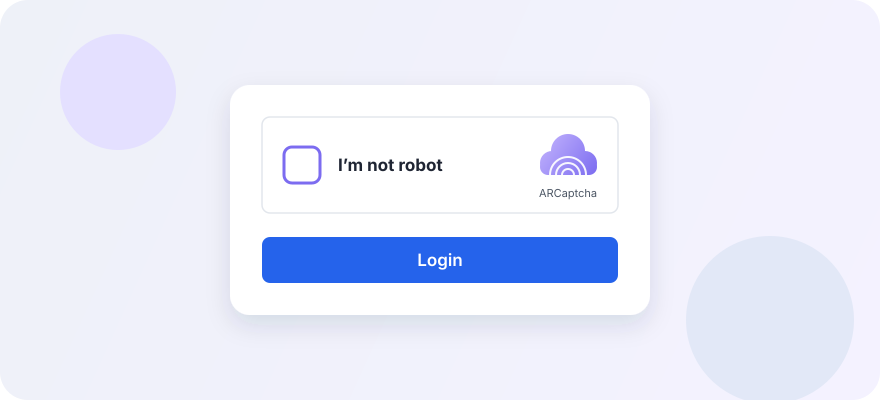

# ARCaptcha

**Complexity: ⭐⭐⭐ (Medium)**

ARCaptcha is a hosted CAPTCHA and bot-protection service for web and mobile applications. Its widget can run an interactive challenge or an invisible flow; the provider decides whether a visitor needs to see a challenge. The exact appearance can vary by the site's configuration.

#### How it looks:


The standard widget is a white, bordered box placed inside the form: a rounded checkbox with a purple outline, the bold label **"I'm not robot"**, and on the right the purple cloud-with-fingerprint ARCaptcha logo with the word *ARCaptcha* below it. Clicking the checkbox either completes silently or opens a pop-up challenge. A dark theme and Persian (`fa`) / English (`en`) labels are available.

#### Challenge modes:
- **Interactive widget** — a visitor is shown the configured verification experience.
- **Invisible mode** — detection starts at a protected action; it may complete without an interruption or show an interactive challenge.

The official documentation describes these modes. It does not establish that every integration uses a particular puzzle type, so avoid identifying ARCaptcha from a challenge's appearance alone.

#### How to identify:
- Look for ARCaptcha branding: an "I'm not robot" checkbox next to the purple cloud/fingerprint logo.
- Integrations documented by ARCaptcha use a widget container with the `arcaptcha` class and a public `data-site-key` attribute.
- A successful widget submission may include a form field named `arcaptcha-token`.
- Invisible mode may not display a widget until the visitor starts the protected action.

These are clues, not proof: inspect only pages you own or are authorized to assess, and do not treat a public site key as a secret or as authorization to use another site's service.

#### How the integration works:
1. The site loads the ARCaptcha client widget and configures it with its public site key.
2. The visitor uses the normal widget flow; an invisible configuration may complete silently or request an interactive step.
3. After successful completion, the client receives a challenge token (commonly submitted as `arcaptcha-token`).
4. The site's backend sends the token to ARCaptcha's official Verify API with the expected site key and the account secret key.
5. The backend permits the protected action only when server verification succeeds. The secret key must stay on the server; a client callback alone is not proof of verification.

#### Completing a challenge as a visitor:
- Follow the instructions shown by the widget and use its own controls; do not try to automate or circumvent a site's verification.
- If it does not load, allow the page's required JavaScript and network requests, check that the browser is up to date, and retry once.
- If the widget is inaccessible, repeatedly fails, or blocks a legitimate action, use the site's accessibility or support channel. Only the site operator can offer an alternative verification route.

#### Free bypass methods:

The public demo uses a checkbox followed by a slider puzzle. A practical setup is **Patchright** (or **DrissionPage**) for the browser layer plus **PuzzleCaptchaSolver** for the gap detection. Patchright drives the page, reads the exact images the widget displayed, and performs the drag; PuzzleCaptchaSolver takes the two images and returns the gap position.

| Tool | Role | Link |
|------|------|------|
| **Patchright** | 🔥 Stealth Playwright fork: browser control, image capture, human-like drag | [Kaliiiiiiiiii-Vinyzu/patchright-python](https://github.com/Kaliiiiiiiiii-Vinyzu/patchright-python) |
| **PuzzleCaptchaSolver** | 🔥 OpenCV gap detection from the background and puzzle-piece images | [vsmutok/PuzzleCaptchaSolver](https://github.com/vsmutok/PuzzleCaptchaSolver) |
| **DrissionPage** | Alternative Chromium controller; can replace Patchright for the browser layer | [g1879/DrissionPage](https://github.com/g1879/DrissionPage) |
| **OpenCV** | Underlying image processing used by the solver | [opencv/opencv-python](https://github.com/opencv/opencv-python) |
| **ddddocr** | Fallback for simple slider/click tasks | [sml2h3/ddddocr](https://github.com/sml2h3/ddddocr) |

#### How the flow works:

1. **Fill the form first.** Set `#email` and `#password` to `demo` / `demo` before touching the widget.
2. **Click the checkbox like a person.** The visible target is `#input-checkbox`; a plain locator click often does not trigger the widget. Move the mouse, press, hold for a short random time, then release.
3. **Read the puzzle layout.** When `.arc-puzzle` appears, read the background (`img.tw-object-contain`), the piece (`img.puzzle`), and the slider handle (`.draggable`). Compute the display scale from the rendered width and `naturalWidth`.
4. **Save the exact images.** Fetch the two `src` URLs with the browser session and write them to temporary files, so the solver works on the same pixels the page displayed.
5. **Find the gap.** `PuzzleCaptchaSolver(...).discern()` removes whitespace, runs Canny edge detection on both images, and uses template matching to return the gap's x coordinate in natural image pixels.
6. **Drag the slider.** The distance is `gap_x * scale - piece_left`. Move with cubic easing and small pauses, then wait for `#checked-in-the-box` and read `#arcaptcha-token`.
7. **Submit the form** and check the `/api/login` response.

#### Example: Patchright + PuzzleCaptchaSolver

```python
import tempfile
from pathlib import Path

from patchright.sync_api import sync_playwright
from main import PuzzleCaptchaSolver  # module name from your PuzzleCaptchaSolver checkout

URL = "https://demo.arcaptcha.co/"

with sync_playwright() as p:
    browser = p.chromium.launch(headless=False)
    page = browser.new_page()
    page.goto(URL, wait_until="domcontentloaded")

    page.fill("#email", "demo")
    page.fill("#password", "demo")

    # Human-like press-and-hold on the checkbox
    box = page.locator("#input-checkbox").bounding_box()
    page.mouse.move(box["x"] + box["width"] / 2, box["y"] + box["height"] / 2, steps=10)
    page.mouse.down()
    page.wait_for_timeout(120)
    page.mouse.up()

    page.locator(".arc-puzzle").wait_for(state="visible", timeout=20_000)

    bg = page.locator(".arc-puzzle img.tw-object-contain")
    piece = page.locator(".arc-puzzle img.puzzle")
    slider = page.locator(".arc-puzzle .draggable")

    bg_box = bg.bounding_box()
    piece_box = piece.bounding_box()
    slider_box = slider.bounding_box()
    scale = bg_box["width"] / bg.evaluate("el => el.naturalWidth")

    # Save the exact images the page displayed
    tmp = Path(tempfile.mkdtemp())
    bg_path, piece_path = tmp / "bg.png", tmp / "piece.png"
    bg_path.write_bytes(page.request.get(bg.get_attribute("src")).body())
    piece_path.write_bytes(page.request.get(piece.get_attribute("src")).body())

    gap_x = PuzzleCaptchaSolver(
        gap_image_path=str(piece_path),
        bg_image_path=str(bg_path),
        output_image_path=str(tmp / "result.png"),
    ).discern()

    distance = gap_x * scale - (piece_box["x"] - bg_box["x"])

    # Drag the slider with cubic easing
    start_x = slider_box["x"] + slider_box["width"] / 2
    start_y = slider_box["y"] + slider_box["height"] / 2
    page.mouse.move(start_x, start_y, steps=8)
    page.mouse.down()
    steps = max(20, int(abs(distance) / 6))
    for i in range(1, steps + 1):
        progress = 1 - (1 - i / steps) ** 3
        page.mouse.move(start_x + distance * progress, start_y)
        page.wait_for_timeout(12)
    page.mouse.up()

    page.wait_for_selector("#checked-in-the-box", timeout=10_000)
    print("token:", page.locator("#arcaptcha-token").input_value())
    browser.close()
```

DrissionPage can replace Patchright for the browser layer (open the page, click `#arc-checkbox`, read the image URLs), but the gap detection and drag logic stay the same. Patchright is the better default here because its patched fingerprints survive the widget's checks more reliably.

#### Practical tips:
- Keep one browser session for checkbox → puzzle → token → submit; reloading the widget can invalidate the token.
- Use the exact images the page displayed (fetch them with the browser session) instead of re-downloading from a different context.
- A human-like press-and-hold on the checkbox matters more than the click itself.
- If the checkbox passes without a puzzle, skip the slider step and continue to the form.
- Run the demo with a visible browser first; headless mode is detected more often.

#### Official demo:
ARCaptcha hosts a public demo page at **[demo.arcaptcha.co](https://demo.arcaptcha.co/)** — a sample login form (`demo` / `demo`) with the standard "I'm not robot" widget. It is the safest place to see what the widget looks like, how the checkbox and pop-up challenge behave, and what the `arcaptcha-token` field looks like in a form submission, without touching a real site. The example above uses this page as its target.

#### Testing an integration you own:
- Use a staging site and credentials configured for that environment; keep the secret key in server-side configuration.
- Verify both accepted and rejected submissions through the official API. Include missing, malformed, expired, and already-used tokens in negative tests.
- Confirm the protected action is not accepted based only on a browser callback, hidden field, or client-provided success flag.
- Check the configured domain, site key, script loading, Content Security Policy, and server-to-server connectivity when verification fails.
- Consult the current [ARCaptcha installation guide](https://docs.arcaptcha.co/installation) and [Verify API reference](https://docs.arcaptcha.co/API/Verify) for the exact request format and error codes.

#### References:
- [ARCaptcha documentation](https://docs.arcaptcha.co/)
- [Official demo page](https://demo.arcaptcha.co/)
- [Quick start](https://docs.arcaptcha.co/quick%20start)
- [Installation and server verification](https://docs.arcaptcha.co/installation)
- [Invisible widget](https://docs.arcaptcha.co/invisible%20captcha)
- [Verify API](https://docs.arcaptcha.co/API/Verify)

This guide covers normal use, authorized integration testing and documented research approaches. Use it only on systems you own or are authorized to test, and respect applicable law, privacy and the terms of the services you use.