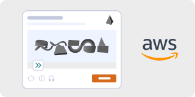

# Amazon WAF CAPTCHA

**Complexity: ⭐⭐⭐ (Medium)**

AWS WAF provides two related mechanisms:

| Mechanism | What happens | What you see |
|-----------|--------------|--------------|
| **AWS WAF CAPTCHA** | The user must solve a puzzle | Distorted-text image + audio option |
| **AWS WAF Challenge** | A silent browser challenge runs in JS | Nothing; a token is issued if the check passes |

Both are configured through AWS WAF rules (including Bot Control) and are often used together with rate limiting and IP reputation.

#### How it looks:

#### How to identify:
- AWS / Amazon branding on the challenge page
- "Enter the characters you see" text challenge, with an audio icon
- Requests to `*.token.awswaf.com`, `captcha.awswaf.com`, or `*.awswaf.com`
- Cookies `aws-waf-token`; header `x-aws-waf-token`
- Script names containing `challenge.js`, `captcha.js`, or `awswaf`
- Response headers/body mentioning `AWSWAF` or `awswaf`

#### How it works:
1. A WAF rule matches the request and returns a CAPTCHA or Challenge action.
2. The browser loads the AWS WAF JS, which runs a proof-of-work/fingerprint check.
3. For CAPTCHA, the user solves an image/audio puzzle; for Challenge, the JS solves silently.
4. On success AWS issues an `aws-waf-token` cookie.
5. The token is sent with subsequent requests and validated by the WAF.

---

### Free bypass methods

| Method | Description | Success Rate | Link |
|--------|-------------|--------------|------|
| **Whisper** | 🔥 Transcribe the audio challenge, then submit | 85-95% | [openai/whisper](https://github.com/openai/whisper) |
| **ddddocr** | OCR for the text challenge | 60-80% | [sml2h3/ddddocr](https://github.com/sml2h3/ddddocr) |
| **EasyOCR / PaddleOCR** | Better OCR after preprocessing | 65-85% | [JaidedAI/EasyOCR](https://github.com/JaidedAI/EasyOCR) |
| **DrissionPage** | 🔥 Run the real AWS WAF JS, keep the token and cookies | 75-90% | [g1879/DrissionPage](https://github.com/g1879/DrissionPage) |
| **Patchright / Camoufox** | Stealth browsers for Challenge actions | 70-90% | [Kaliiiiiiiiii-Vinyzu/patchright-python](https://github.com/Kaliiiiiiiiii-Vinyzu/patchright-python) |
| **undetected-chromedriver** | Patched Selenium for the challenge flow | 65-85% | [ultrafunkamsterdam/undetected-chromedriver](https://github.com/ultrafunkamsterdam/undetected-chromedriver) |

### Two practical routes
- **Challenge action (silent):** use a real browser and let `challenge.js` run. Extract `aws-waf-token` from the cookie jar and reuse it with the same User-Agent, TLS stack and IP. `curl_cffi` with browser impersonation can work if the fingerprint matches.
- **CAPTCHA action (visible):** switch to audio and transcribe with Whisper, or OCR the text image. Submit the answer in the widget; AWS then issues the token.

### Practical tips
- `aws-waf-token` is bound to the client context; changing IP or User-Agent mid-session usually invalidates it.
- The audio challenge may be rate-limited; don't loop it aggressively.
- For OCR, crop the image, remove noise and use a character whitelist — AWS text is usually clear but distorted.
- Keep the browser session alive: the token refresh logic is part of the WAF JS.
- Headless Chrome without stealth patches is a strong bot signal; prefer a real browser profile.

---

#### 💰 Paid alternatives:

| Service | AWS WAF support | Notes |
|---------|-----------------|-------|
| **2Captcha** | Amazon WAF CAPTCHA | Token-based |
| **CapSolver** | AWS WAF CAPTCHA / Challenge | AI-based, fast |
| **Anti-Captcha** | Amazon WAF | Availability varies by task type |
| **YesCaptcha** | AWS WAF | Alternative provider |

If free methods don't work, use API services: **2Captcha**, **Anti-Captcha**, or **CapSolver**. More details in the [Paid services](../solvers.md#paid-services-api) section.
