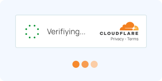

# Cloudflare Turnstile & Challenge

Cloudflare is the world's most ubiquitous web infrastructure and security platform, protecting tens of millions of websites. When dealing with Cloudflare protection, it is vital to distinguish between its two distinct defensive architectures: **Cloudflare Turnstile** (an embeddable smart CAPTCHA widget) and **Cloudflare Challenge / Bot Management** (an edge-level WAF interstitial barrier).

---

## 📊 Comparison: Turnstile vs. Edge Challenge

| Feature / Metric | Cloudflare Turnstile (Widget) | Cloudflare Edge Challenge / Bot Management |
|------------------|-------------------------------|--------------------------------------------|
| **Product Type** | Embeddable CAPTCHA replacement widget | Edge WAF / CDN anti-bot interstitial page |
| **Trigger Mechanism** | Embedded in web forms (Login, Signup, Checkout) | Triggered by WAF rules, IP threat score, Bot Fight Mode |
| **User Experience** | Non-interactive auto-solve or interactive checkbox | "Just a moment...", "Checking your browser", full-page reload |
| **Output / Artifact** | Cryptographic token in `cf-turnstile-response` | `cf_clearance` cookie (+ session `__cf_bm` cookies) |
| **Lifespan** | **300 seconds (5 minutes)**; single-use token | Variable (typically 30 minutes to 24 hours per IP/UA) |
| **Server Verification** | Backend queries `challenges.cloudflare.com/turnstile/v0/siteverify` | Validated automatically at Cloudflare's Edge reverse-proxy |
| **Complexity** | ⭐⭐⭐ (Medium) | ⭐⭐⭐⭐⭐ (Very High) |

---

## 🛠️ Architecture & Under the Hood

### 1. Cloudflare Turnstile Architecture
Turnstile is designed as a privacy-first alternative to reCAPTCHA that eliminates visual puzzles in favor of machine learning heuristics and cryptographic proofs:
- **Client Script**: Loaded via `https://challenges.cloudflare.com/turnstile/v0/api.js`.
- **Sandboxed Iframe**: Renders inside an isolated cross-origin iframe (`challenges.cloudflare.com/cdn-cgi/challenge-platform/h/b/turnstile/...`).
- **Telemetry & Signal Evaluation**:
  - **Proof-of-Work (PoW)**: Solves dynamic cryptographic mathematical challenges client-side (SHA-256 or custom hashing algorithms).
  - **Private Access Tokens (PAT) / Privacy Pass**: Leverages cryptographic state tokens on supported platforms (macOS / iOS / Android) to verify hardware authenticity without tracking.
  - **CDP & Automation Detection**: Inspects DevTools hooks, `Runtime.enable` artifacts, prototype modifications, `navigator.webdriver`, and execution timing quirks.
  - **Interactive Verification**: If risk heuristics are elevated, displays a manual "Verify you are human" checkbox widget.
- **Token Submission**: Once verified, places a base64-encoded signed payload into a hidden input `<input type="hidden" name="cf-turnstile-response" id="cf-turnstile-response">`.

```
[ Visitor / Browser ] ───> [ Turnstile Widget JS ] ───> [ PoW + Telemetry + PAT ]
                                                                 │
[ Form Submission ] <─── [ cf-turnstile-response Token ] <───────┘
        │
        ▼
[ Website Origin Server ] ───> POST /turnstile/v0/siteverify ───> [ Cloudflare API ] (Returns JSON)
```

### 2. Cloudflare Edge Challenge & Bot Management (WAF)
Cloudflare's Edge Bot Management operates at Layers 3, 4, and 7 before traffic reaches the customer's origin server:
- **Detection Layers**:
  - **TLS Fingerprinting (JA3 / JA4 / Akamai Fingerprint)**: Inspects TLS cipher suites, extensions, elliptic curves, and TCP/IP window sizes to distinguish real browsers from automated HTTP clients (e.g., standard Python `requests`, `aiohttp`, `Go-http-client`).
  - **HTTP/2 & HTTP/3 Frame Signatures**: Inspects SETTINGS parameters, WINDOW_UPDATE frames, and header ordering pseudo-headers (`:method`, `:authority`, `:scheme`, `:path`).
  - **Behavioral ML Engine**: Analyzes request velocity, historical IP ASN reputation, request sequences, and behavioral anomalies across Cloudflare's global network.
- **Challenge Escalation Flow**:
  1. **HTTP 403 / 503 Mitigation**: Edge intercepts request and serves the interstitial page with header `cf-mitigated: challenge`.
  2. **JavaScript Orchestration**: Loads `/cdn-cgi/challenge-platform/h/b/orchestrate/chl_page/v1` to execute deep environment diagnostics.
  3. **Clearance Issuance**: On successful verification, sets the `cf_clearance` cookie strictly bound to the client's **IP Address + User-Agent + TLS Fingerprint**.

---

## 🔍 Detailed Product Breakdown

### 1. Cloudflare Turnstile

#### How it looks:


#### DOM & Script Identification:
- Script tag: `<script src="https://challenges.cloudflare.com/turnstile/v0/api.js" async defer></script>`
- Container: `<div class="cf-turnstile" data-sitekey="0x4AAAAAA..." data-callback="onTurnstileSuccess"></div>`
- Hidden field: `<input type="hidden" name="cf-turnstile-response" value="...">`
- Iframe selector: `iframe[src*="challenges.cloudflare.com"]` (id prefixed with `cf-chl-widget-`)
- Global JS API: `turnstile.render()`, `turnstile.reset()`, `turnstile.getResponse()`, `turnstile.execute()`

#### Widget Modes:
1. **Managed**: Cloudflare runs background checks; automatically presents an interactive checkbox only when risk signals are borderline.
2. **Non-Interactive**: Fully automatic zero-click execution that displays a loading spinner and success checkmark.
3. **Invisible**: No visible UI rendered in the DOM; invoked purely via JavaScript (`turnstile.execute()`).

---

### 2. Cloudflare Edge Challenge (JS, Managed & Under Attack Mode)

#### How it looks:
- Full-page interstitial: *"Just a moment... Enable JavaScript and cookies to continue"*.
- Displays Cloudflare Ray ID and protected domain details.
- May include an embedded interactive verification box.

#### DOM & Network Identification:
- HTTP Response: Status `403 Forbidden` or `503 Service Temporarily Unavailable`.
- Response Headers:
  - `server: cloudflare`
  - `cf-mitigated: challenge`
  - `cf-ray: 8e1...`
- Key Cookies:
  - `cf_clearance`: Core authorization cookie allowing bypass of subsequent edge challenges.
  - `__cf_bm`: Cloudflare Bot Management tracking cookie (30-minute lifespan).
  - `cf_chl_*`: Ephemeral challenge state cookies.

---

## 🧪 Official Test Keys & Testing Environments

### 🔑 Cloudflare Official Dummy Keys
Cloudflare provides official test keys for integration testing. These keys work on all domains (including `localhost` and `127.0.0.1`):

#### Client-Side Dummy Sitekeys:
| Sitekey | Behavior | Widget Mode | Purpose |
|---------|----------|-------------|---------|
| `1x00000000000000000000AA` | **Always passes** | Visible | Test successful form submission flows |
| `2x00000000000000000000AB` | **Always fails** | Visible | Test client-side error handling & retries |
| `1x00000000000000000000BB` | **Always passes** | Invisible | Test invisible widget execution |
| `2x00000000000000000000BB` | **Always fails** | Invisible | Test invisible widget failure handling |
| `3x00000000000000000000FF` | **Forces interactive challenge** | Visible | Test manual checkbox interaction workflows |

#### Server-Side Dummy Secret Keys:
| Secret Key | Validation Result | Error Code |
|------------|-------------------|------------|
| `1x0000000000000000000000000000000AA` | `{"success": true}` | None |
| `2x0000000000000000000000000000000AA` | `{"success": false}` | `invalid-input-response` |
| `3x0000000000000000000000000000000AA` | `{"success": false}` | `timeout-or-duplicate` |

---

### 🌐 Live Testing & Benchmark Environments

| Environment | URL | Type | Description |
|-------------|-----|------|-------------|
| **Cloudflare Turnstile docs** | [developers.cloudflare.com/turnstile](https://developers.cloudflare.com/turnstile/) | Turnstile | Product docs, widget modes, siteverify |
| **Official dummy-key matrix** | [testing](https://developers.cloudflare.com/turnstile/troubleshooting/testing/) | Turnstile | Predictable pass / fail / interactive keys |
| **Peet Turnstile Demo** | [peet.it/turnstile](https://peet.it/turnstile/) | Turnstile | Clean community demo page with multiple widget modes |
| **ZeroCDN Turnstile Lab** | [turnstile.zerocdn.com](https://turnstile.zerocdn.com/) | Turnstile | Public Turnstile testbed for token extraction |
| **NowSecure Challenge Lab** | [nowsecure.nl](https://nowsecure.nl/) | WAF Challenge | Classic Cloudflare Edge Managed Challenge test domain |
| **2Captcha Turnstile Playground** | [2captcha.com/demo/cloudflare-turnstile](https://2captcha.com/demo/cloudflare-turnstile) | Turnstile | Live test sandbox for token insertion and callback tests |
| **2Captcha Challenge Playground** | [2captcha.com/demo/cloudflare-turnstile-challenge](https://2captcha.com/demo/cloudflare-turnstile-challenge) | Managed Challenge | Live interactive challenge test bed |
| **CapMonster Cloud Turnstile Demo** | [capmonster.cloud/en/demo/turnstile](https://capmonster.cloud/en/demo/turnstile) | Turnstile | Interactive sandbox with event callbacks |
| **ScrapingCourse Turnstile** | [scrapingcourse.com/cloudflare-turnstile](https://www.scrapingcourse.com/cloudflare-turnstile) | Turnstile | Web scraping benchmark suite |

---

## 🛠️ Bypass Methods & Engineering Approaches

### Method 1: Anti-CDP Browser Automation (Turnstile & Interactive WAF)
Standard Playwright and Puppeteer leak Chrome DevTools Protocol (`Runtime.enable`, `Page.addScriptToEvaluateOnNewDocument`) which Cloudflare detects immediately.

- **Solution**: Use patched automation frameworks that eliminate CDP artifacts:
  - **rebrowser-patches**: Patches Playwright/Puppeteer source to isolate CDP execution contexts.
  - **SeleniumBase UC Mode (`sb.uc_gui_click_cf()`)**: Native PyAutoGUI/CDP reconnect technology that clicks Turnstile checkboxes with genuine OS-level mouse events.
  - **Camoufox**: C++ patched Firefox engine designed specifically to resist browser fingerprinting and canvas/WebGL probes.
  - **nodriver**: Async Python CDP client operating without standard WebDriver binaries.

### Method 2: Hybrid Clearance Harvesting + TLS Impersonation (Edge Challenges)
When scraping high-volume endpoints protected by Cloudflare WAF, running full browser instances for every request is computationally prohibitive.

```
[ Anti-Detect Browser (Camoufox / UC Mode) ]
                    │
                    ▼ (Solve Managed Challenge once)
         [ Extract cf_clearance + Cookies + UA ]
                    │
                    ▼
[ curl_cffi / tls-client / rhttp (Python/Go) ] ───> [ High-Speed HTTP/2 API Scraping ]
  (Matches JA3/JA4 TLS Fingerprint + Headers)
```

- **Crucial Rule**: The `cf_clearance` cookie is cryptographically bound to the **Client IP**, **User-Agent**, and **TLS Fingerprint**. Sending the cookie via standard `requests` or `urllib` fails because Python's OpenSSL TLS fingerprint does not match Chrome's BoringSSL fingerprint. Use **`curl_cffi`** (with `impersonate="chrome124"`).

### Method 3: Standalone Bypass Proxy Servers
- **FlareSolverr / Solverr**: Local Docker-based HTTP proxies that intercept requests, solve Cloudflare challenges using headless Chromium/Camoufox, and return the resolved HTML content and cookies.

---

## 📂 Open-Source Projects & GitHub Ecosystem

A curated directory of open-source tools, solvers, and stealth engines specialized in Cloudflare:

### 🧩 Solvers & Cloudflare Automation Tools

| Repository | Tech Stack | Highlights | Link |
|------------|------------|------------|------|
| **sarperavci/CloudflareBypassForScraping** | Python (DrissionPage) | 🔥 High-performance Turnstile & Challenge solver server | [sarperavci/CloudflareBypassForScraping](https://github.com/sarperavci/CloudflareBypassForScraping) |
| **FlareSolverr/FlareSolverr** | TypeScript / Chromium | 🔥 Standard proxy server for bypassing Cloudflare & DDoS-GUARD | [FlareSolverr/FlareSolverr](https://github.com/FlareSolverr/FlareSolverr) |
| **unseensnick/Solverr** | Python / Docker | FlareSolverr alternative combining Camoufox and Chrome engines | [unseensnick/Solverr](https://github.com/unseensnick/Solverr) |
| **xHossein/PyPasser** | Python | Open-source solver for Turnstile, reCAPTCHA, and anti-bot walls | [xHossein/PyPasser](https://github.com/xHossein/PyPasser) |
| **ismoiloffS/EzSolver** | Python | Local HTTP API service auto-solving invisible and managed Turnstile | [ismoiloffS/EzSolver](https://github.com/ismoiloffS/EzSolver) |
| **SolveGate/playwright-turnstile** | TypeScript / Playwright | Helper for reading sitekey, waiting for tokens, and injecting results | [SolveGate/playwright-turnstile](https://github.com/SolveGate/playwright-turnstile) |
| **VeNoMouS/cloudscraper** | Python | Legacy JS challenge solver (effective only against basic/legacy setups) | [VeNoMouS/cloudscraper](https://github.com/VeNoMouS/cloudscraper) |

### 🛡️ Anti-Detect & Stealth Automation

| Repository | Tech Stack | Description | Link |
|------------|------------|-------------|------|
| **D4Vinci/Scrapling** | Python | 🔥 Undetectable web scraping framework with built-in Turnstile & Interstitial bypass fetchers | [D4Vinci/Scrapling](https://github.com/D4Vinci/Scrapling) |
| **Kaliiiiiiiiii-Vinyzu/patchright-python** | Python (Playwright) | 🔥 Undetected Playwright build with native CDP leak patches and humanized mouse physics | [Kaliiiiiiiiii-Vinyzu/patchright](https://github.com/Kaliiiiiiiiii-Vinyzu/patchright) · [Python](https://github.com/Kaliiiiiiiiii-Vinyzu/patchright-python) |
| **seleniumbase/SeleniumBase** | Python | 🔥 Undetected UC Mode with `uc_gui_click_cf()` for Turnstile | [seleniumbase/SeleniumBase](https://github.com/seleniumbase/SeleniumBase) |
| **rebrowser/rebrowser-patches** | Node.js / Playwright / Puppeteer | 🔥 Eliminates CDP `Runtime.enable` leaks detected by Cloudflare | [rebrowser/rebrowser-patches](https://github.com/rebrowser/rebrowser-patches) |
| **daijro/camoufox** | Python / C++ | Stealth Firefox fork with spoofed hardware fingerprints | [daijro/camoufox](https://github.com/daijro/camoufox) |
| **unclecode/crawl4ai** | Python | LLM-ready crawler with Playwright stealth mode and anti-bot evasion | [unclecode/crawl4ai](https://github.com/unclecode/crawl4ai) |
| **omkarcloud/botasaurus** | Python / JS | All-in-one scraping framework with built-in Cloudflare & anti-bot evasion | [omkarcloud/botasaurus](https://github.com/omkarcloud/botasaurus) |
| **daijro/browserforge** | Python | Statistical browser header, client-hint, and device fingerprint generator | [daijro/browserforge](https://github.com/daijro/browserforge) |
| **g1879/DrissionPage** | Python | Controls browser directly via socket CDP without WebDriver | [g1879/DrissionPage](https://github.com/g1879/DrissionPage) |
| **ultrafunkamsterdam/nodriver** | Python | Next-generation async Python browser automation engine | [ultrafunkamsterdam/nodriver](https://github.com/ultrafunkamsterdam/nodriver) |
| **berstend/puppeteer-extra** | Node.js | Modular plugin framework including `puppeteer-extra-plugin-stealth` | [berstend/puppeteer-extra](https://github.com/berstend/puppeteer-extra) |

### 🌐 TLS / JA3 / JA4 & HTTP/2 Impersonation

| Repository | Tech Stack | Description | Link |
|------------|------------|-------------|------|
| **lexiforest/curl_cffi** | Python / C | Python binding for `curl-impersonate` (JA3/JA4, HTTP/2 fingerprinting) | [lexiforest/curl_cffi](https://github.com/lexiforest/curl_cffi) |
| **lwthiker/curl-impersonate** | C / Libcurl | Modified curl that impersonates browser TLS and HTTP handshakes | [lwthiker/curl-impersonate](https://github.com/lwthiker/curl-impersonate) |
| **bogdanfinn/tls-client** | Go / Python | Advanced HTTP client supporting full TLS/JA3/JA4 fingerprint profiles | [bogdanfinn/tls-client](https://github.com/bogdanfinn/tls-client) |

---

## 📖 Official docs, labs, and reading

This page does not include ready-made scripts. Below is a map of official pages, live labs, and write-ups you can use to build your own integration or research.

### Vendor documentation

| Topic | Why it matters | Page |
|-------|----------------|------|
| Turnstile overview | A product separate from the CDN: the widget can be embedded on a site that is not proxied through Cloudflare | [Turnstile docs](https://developers.cloudflare.com/turnstile/) · [Get started](https://developers.cloudflare.com/turnstile/get-started/) |
| Widget modes | Managed, Non-Interactive, Invisible: when a checkbox appears and when it does not | [Widget concepts](https://developers.cloudflare.com/turnstile/concepts/widget/) |
| Client embed | `api.js`, implicit vs explicit render, `data-sitekey`, `data-action`, `data-cdata`, callbacks | [Client-side rendering](https://developers.cloudflare.com/turnstile/get-started/client-side-rendering/) |
| Siteverify | `POST /turnstile/v0/siteverify`, response fields, error codes, single-use token valid for 300 seconds | [Server-side validation](https://developers.cloudflare.com/turnstile/get-started/server-side-validation/) |
| Dummy keys | Predictable sitekey/secret pairs for CI, localhost, and negative cases | [Testing](https://developers.cloudflare.com/turnstile/troubleshooting/testing/) |
| Challenge Pages | Full-screen interstitial, managed, and interactive challenges at the network edge | [Challenges](https://developers.cloudflare.com/cloudflare-challenges/) · [Challenge types](https://developers.cloudflare.com/cloudflare-challenges/challenge-types/) |
| JavaScript Detections | Where `cf_clearance` and the `js_detection.passed` field come from | [JavaScript detections](https://developers.cloudflare.com/cloudflare-challenges/challenge-types/javascript-detections/) |
| Bot Management | Bot score 1–99, verified bots, custom rules | [Bot Management](https://developers.cloudflare.com/bots/get-started/bot-management/) |
| JA3 / JA4 | How the edge computes a TLS fingerprint and where it shows up in logs and WAF | [JA3/JA4 fingerprint](https://developers.cloudflare.com/bots/additional-configurations/ja3-ja4-fingerprint/) |
| Private Access Tokens | Why the challenge often disappears on Apple devices without a puzzle | [Eliminating CAPTCHAs with PATs](https://blog.cloudflare.com/eliminating-captchas-on-iphones-and-macs-using-new-standard/) |
| Product launch | Original positioning of Turnstile as a reCAPTCHA replacement | [Turnstile GA announcement](https://blog.cloudflare.com/turnstile-private-captcha-alternative/) |

### Live pages worth opening in a browser

| Page | What you actually see |
|------|------------------------|
| [developers.cloudflare.com/turnstile/troubleshooting/testing](https://developers.cloudflare.com/turnstile/troubleshooting/testing/) | Official dummy sitekey matrix and the expected `XXXX.DUMMY.TOKEN.XXXX` token behavior |
| [peet.it/turnstile](https://peet.it/turnstile/) | Clean community widget demo next to a fingerprint lab |
| [tls.peet.ws](https://tls.peet.ws/) | JA3/JA4, HTTP/2, and Client Hints for the same session — useful for comparing a browser and an HTTP client |
| [turnstile.zerocdn.com](https://turnstile.zerocdn.com/) | Public bench for watching the iframe and the `cf-turnstile-response` field |
| [nowsecure.nl](https://nowsecure.nl/) | Classic full-page Managed Challenge ("Just a moment…") |
| [scrapingcourse.com/cloudflare-turnstile](https://www.scrapingcourse.com/cloudflare-turnstile) | Turnstile training ground |
| [scrapingcourse.com/cloudflare-challenge](https://www.scrapingcourse.com/cloudflare-challenge) | Edge challenge training ground |
| [2captcha.com/demo/cloudflare-turnstile](https://2captcha.com/demo/cloudflare-turnstile) | Widget sandbox with field descriptions |
| [2captcha.com/demo/cloudflare-turnstile-challenge](https://2captcha.com/demo/cloudflare-turnstile-challenge) | Interactive challenge |
| [capmonster.cloud/en/demo/turnstile](https://capmonster.cloud/en/demo/turnstile) | Demo with callback events |
| [bot.sannysoft.com](https://bot.sannysoft.com/) | Quick checklist of automation leaks that Cloudflare also looks at |
| [abrahamjuliot.github.io/creepjs](https://abrahamjuliot.github.io/creepjs/) | Deep fingerprint: canvas, WebGL, lies, headless |

### Write-ups and reference repos

- [Troy Hunt — Fighting API bots with Invisible Turnstile](https://www.troyhunt.com/fighting-api-bots-with-cloudflares-invisible-turnstile/) — a real production write-up: challenge volume, pass rate, and JA3 concentration among failures.
- [feder-cr/invisible_playwright — Cloudflare Turnstile explained](https://github.com/feder-cr/invisible_playwright/blob/main/docs/cloudflare-turnstile-explained.md) — a short breakdown of modes, siteverify, and signals, with links to primary sources.
- [FoxIO-LLC/ja4](https://github.com/FoxIO-LLC/ja4) — the JA4 specification that Bot Management shows alongside JA3.
- [lwthiker/curl-impersonate](https://github.com/lwthiker/curl-impersonate) — why a normal HTTP client does not match a Chrome fingerprint even with the correct `User-Agent`.
- [rebrowser/rebrowser-bot-detector](https://github.com/rebrowser/rebrowser-bot-detector) — an open detector for CDP leaks that Turnstile and Challenge react to.
- [rebrowser.net docs](https://rebrowser.net/docs/playwright-puppeteer-leak-patches) — why `Runtime.enable` breaks a "clean" Playwright/Puppeteer session.
- [SeleniumBase UC Mode](https://seleniumbase.io/help_docs/uc_mode/) — docs for the mode that clicks Turnstile with a system mouse, not a synthetic CDP click.
- [Camoufox](https://camoufox.com/) — stealth Firefox and which fingerprints are spoofed at the engine level.
- [D4Vinci/Scrapling](https://github.com/D4Vinci/Scrapling) — a framework with `StealthyFetcher` and built-in Turnstile/interstitial handling.
- [Kaliiiiiiiiii-Vinyzu/patchright](https://github.com/Kaliiiiiiiiii-Vinyzu/patchright) — a Playwright fork without the usual CDP artifacts; Python port: [patchright-python](https://github.com/Kaliiiiiiiiii-Vinyzu/patchright-python).

---

## 💰 Paid Unblockers & Token APIs

When managing enterprise volumes or dynamic rotating challenge walls, commercial API services handle token generation or full-page unblocking:

| Service | Supported Capabilities | Method |
|---------|------------------------|--------|
| [**CapSolver**](https://www.capsolver.com/) | Turnstile, Managed Challenge, `cf_clearance` | Token API / Proxy Task |
| [**2Captcha**](https://2captcha.com/) | Turnstile (all modes), Cloudflare Challenge | Token API (`TurnstileTaskProxyless`) |
| [**Anti-Captcha**](https://anti-captcha.com/) | Turnstile token solver | Custom Task Proxy |
| [**Bright Data Unblocker**](https://brightdata.com/) | Full Edge Challenge & WAF bypass | Web Unblocker Proxy API |
| [**ZenRows**](https://www.zenrows.com/) | Auto Cloudflare Challenge unblocking | REST Scraping API |
| [**ScrapingBee**](https://www.scrapingbee.com/) | Headless JS rendering + Cloudflare bypass | REST API |

---

## 💡 Practical Engineering Tips & Troubleshooting

1. **IP Reputation & ASN Quality**:
   - Datacenter IPs (AWS, Hetzner, DigitalOcean) trigger continuous interactive challenge loops. Use clean **ISP or Residential proxies**.
2. **Strict IP-Clearance Binding**:
   - `cf_clearance` is cryptographically tied to the outbound IP address. You **cannot** solve the challenge on IP `A` and reuse the cookie on IP `B`.
3. **TLS Stack Uniformity**:
   - Never solve a challenge in a browser and reuse cookies in standard Python `requests`. Always use `curl_cffi` or `tls-client` with matching TLS/JA4 signatures.
4. **Iframe Cross-Origin Handling**:
   - Turnstile widgets reside inside cross-origin iframes. In standard Playwright scripts, regular `.click()` may fail due to sandboxing; use coordinate clicks or anti-CDP mouse events (`sb.uc_gui_click_cf()`).
5. **Token Lifetime & Consumption**:
   - Turnstile tokens expire after **300 seconds (5 minutes)** and are strictly single-use. Submit forms immediately after token generation.
