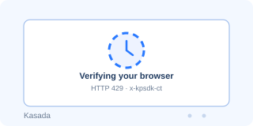

# Kasada

**Complexity: ⭐⭐⭐⭐⭐ (Very High)**

Kasada is a bot-management platform used by airlines, retailers, and ticketing sites. It is not a visual CAPTCHA: the protected page returns a `429` with a challenge script, and the browser must produce a valid token through an obfuscated virtual machine and proof-of-work. There is no checkbox to click.

#### How it looks:

#### How to identify:
- First request returns `429` (sometimes `403`) with `x-kpsdk-*` headers
- Challenge script `ips.js` or `p.js` with a tenant-specific path
- Requests to `/fp`, `/mfc`, and `/tl`
- Headers `x-kpsdk-ct`, `x-kpsdk-cd`, `x-kpsdk-st`, `x-kpsdk-v`, `x-kpsdk-h`
- Cookie `KP_UIDz`
- Binary `POST` to `/tl` with `Content-Type: application/octet-stream`
- Obfuscated bytecode/VM inside the script

#### How it works:
1. A protected request without valid tokens is answered with `429` and the challenge script path.
2. The browser fetches `/fp`, `/mfc`, and `ips.js`, then runs the obfuscated VM.
3. The VM collects fingerprint and environment signals and computes a proof-of-work.
4. It posts an encrypted binary payload to `/tl`; an accepted post returns `x-kpsdk-ct` (session token) and `x-kpsdk-st` (server time).
5. Every protected request carries `x-kpsdk-ct` plus a fresh `x-kpsdk-cd` proof derived from `ct`, `st`, and the request host.
6. `x-kpsdk-h` binds the tokens together; mixing values from different sessions fails.
7. The session token is reusable for a while, but the per-request proof must be recomputed.

#### Why it is hard:
- The script is a custom bytecode VM, not readable JavaScript; the payload layout is not public.
- Instrumentation detection (CDP, Playwright, patched runtimes) runs before any user behaviour.
- Tokens are bound to the session, IP, User-Agent, and client hints.
- The script and `/tl` endpoint are first-party and change per tenant.

---

### Free & open-source bypass methods

| Tool | Description | Success Rate | Link |
|------|-------------|--------------|------|
| **Patchright / Camoufox** | 🔥 Stealth browsers that avoid the most common CDP tells | 40–70% | [Kaliiiiiiiiii-Vinyzu/patchright-python](https://github.com/Kaliiiiiiiiii-Vinyzu/patchright-python) · [daijro/camoufox](https://github.com/daijro/camoufox) |
| **DrissionPage** | Real Chromium session with fine-grained control | 35–65% | [g1879/DrissionPage](https://github.com/g1879/DrissionPage) |
| **SeleniumBase UC mode** | Patched automation for JS-heavy challenges | 35–60% | [seleniumbase/SeleniumBase](https://github.com/seleniumbase/SeleniumBase) |
| **curl_cffi** | TLS impersonation for the non-JS parts of the flow | 20–45% | [lexiforest/curl_cffi](https://github.com/lexiforest/curl_cffi) |
| **nodriver** | CDP-based automation with fewer default leaks | 30–55% | [ultrafunkamsterdam/nodriver](https://github.com/ultrafunkamsterdam/nodriver) |

### Practical approach
1. Use a real browser with a persistent profile and a residential IP.
2. Let the challenge script load and run; do not block `/fp`, `/mfc`, or `/tl`.
3. Keep the cookie jar (`KP_UIDz`) and all `x-kpsdk-*` values from the same session.
4. Apply the returned `x-kpsdk-ct` and `x-kpsdk-v` to protected requests.
5. If `x-kpsdk-cd` is required, compute a fresh proof for every request; do not reuse the old value.
6. If the page still returns `429`, restart with a fresh session and a different IP.

### Practical tips
- Do not mix tokens from different browser sessions or proxy exits.
- `x-kpsdk-ct` changes after `/tl` accepts the payload; always use the newest value.
- Empty `x-kpsdk-*` headers are not the same as omitting them — the sensor can tell.
- Anti-instrumentation checks fire on the first load; a clean headful browser is usually better than a patched headless one.
- Kasada is tenant-specific: a technique that works on one site may fail on another.

---

#### 💰 Paid alternatives:

| Service | Notes |
|---------|-------|
| **Kasada/KPSDK solver APIs** | Specialised services that generate the `/tl` payload and per-request proof |
| **Bright Data / ZenRows / ScrapingBee** | Managed browser unblockers for Kasada-protected pages |
| **Residential proxies** | Required for session consistency; rotating IPs break the token binding |

More details in the [Paid services](../solvers.md#paid-services-api) section.
