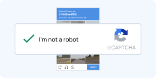
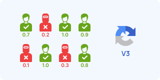
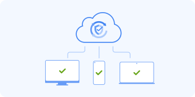

# Google reCAPTCHA

Google reCAPTCHA is the most widely deployed anti-bot and CAPTCHA service on the web, protecting millions of websites across all tiers. Developed and maintained by Google, it has evolved from early distorted text challenges into complex behavioral analytics, machine learning telemetry, and enterprise risk engines.

---

## 📊 Version Comparison Overview

| Version | User Experience | Primary Signal / Engine | Complexity | Typical Use Cases |
|---------|-----------------|-------------------------|------------|-------------------|
| **v1 (Legacy)** | Distorted scanned book text | Text OCR / human transcription | ⭐⭐ | *Deprecated & shut down (2018)* |
| **v2 Checkbox** | "I'm not a robot" checkbox + image/audio tiles | Risk score + behavioral interaction | ⭐⭐⭐ | Login forms, checkout, registration |
| **v2 Invisible** | Background check; challenge pops up if suspicious | Behavioral score + click trigger | ⭐⭐⭐⭐ | High-conversion forms, lead gen |
| **v3** | Frictionless (no user task); returns score `0.0–1.0` | Browser telemetry, history, mouse physics | ⭐⭐⭐⭐ | Site-wide navigation, APIs, search |
| **Enterprise** | v2/v3 style + GCP Assessment API, WAF integration | AI risk engine + account takeover protection | ⭐⭐⭐⭐⭐ | Banks, large e-commerce, cloud platforms |

---

## 🛠️ Architecture & Under the Hood

### 1. Client-Side Lifecycle & Botguard VM
reCAPTCHA runs proprietary obfuscated JavaScript (historically known as **Botguard** or Google Client Telemetry).
- **Initialization**: Loading `https://www.google.com/recaptcha/api.js` (or `/enterprise.js`) downloads an encrypted virtual machine (VM) script.
- **Signal Collection**: The VM collects hundreds of browser metrics:
  - Chrome DevTools Protocol (CDP) artifacts (e.g. `Runtime.enable`, `navigator.webdriver`, CDC variables).
  - Canvas 2D / WebGL / WebAudio hardware fingerprints.
  - Mouse movement curves, acceleration vectors, and keystroke dynamics.
  - Active Google authentication cookies (e.g., `NID`, `SID`, `HSID`) and session history.
- **Iframe Architecture (v2)**:
  - **Anchor iframe** (`/recaptcha/api2/anchor`): Houses the checkbox widget.
  - **Bframe iframe** (`/recaptcha/api2/bframe`): Dynamic iframe overlay containing visual image tiles (3×3 or 4×4) or audio challenges.
- **Challenge Network Flow**:
  1. `POST /recaptcha/api2/reload` — requests challenge parameters or token.
  2. `POST /recaptcha/api2/userverify` — submits user solution (audio transcription, tile selection, or token request).

### 2. Token Lifecycle & Server Validation
- **Token generation**: On success, Google issues a signed cryptographic string placed into a hidden `<textarea id="g-recaptcha-response" name="g-recaptcha-response">`.
- **Expiration**: Tokens are strictly single-use and expire within **120 seconds (2 minutes)**.
- **Server Verification**:
  - **Standard reCAPTCHA (v2/v3)**: The site backend queries:
    `POST https://www.google.com/recaptcha/api/siteverify` with `secret`, `response`, and optional `remoteip`.
  - **reCAPTCHA Enterprise**: Verified via the GCP Assessment API:
    `POST https://recaptchaenterprise.googleapis.com/v1/projects/{project_id}/assessments` with JSON payload containing event details and expected action.

---

## 🔍 Detailed Version Breakdown

### 1. reCAPTCHA v2 Checkbox ("I'm not a robot")
**Complexity: ⭐⭐⭐ (Medium)**

The classic checkbox widget. Clicking the box either passes instantly (1-click pass) or presents an interactive image or audio challenge.

#### How it looks:


#### DOM & Script Identification:
- Script tag: `<script src="https://www.google.com/recaptcha/api.js" async defer></script>`
- Container: `<div class="g-recaptcha" data-sitekey="6L..." data-callback="onSubmitCallback"></div>`
- Response textarea: `<textarea name="g-recaptcha-response" id="g-recaptcha-response" class="g-recaptcha-response"></textarea>`
- Iframes: `src="https://www.google.com/recaptcha/api2/anchor?k=..."` and `src="https://www.google.com/recaptcha/api2/bframe?k=..."`

#### Challenge Variants:
1. **1-Click Green Checkmark**: Granted when the browser fingerprint and IP reputation score exceed the trust threshold.
2. **3×3 Static Tile Selection**: "Select all images with traffic lights/bicycles".
3. **3×3 Dynamic / Fading Tiles**: "Click verify once there are none left" — tiles fade out and new images appear in their place.
4. **4×4 Bounding Grid**: One large image split into 16 smaller squares.
5. **Audio Challenge**: An audio clip with synthesized spoken numbers/words and background noise for accessibility.

---

### 2. reCAPTCHA v2 Invisible
**Complexity: ⭐⭐⭐⭐ (High)**

Invisible v2 binds directly to a button click or custom JS event. It does not show a checkbox on the page.

#### DOM & Script Identification:
- Container button: `<button class="g-recaptcha" data-sitekey="6L..." data-callback="onSuccess">Submit</button>`
- Programmatic trigger: `grecaptcha.execute(widgetId)`
- Badge indicator: Fixed floating badge at bottom-right (`.grecaptcha-badge`), unless hidden via CSS per Google policy.

---

### 3. reCAPTCHA v3 (Score-Based)
**Complexity: ⭐⭐⭐⭐ (High)**

A completely frictionless risk assessment running invisibly across pages. Instead of a binary pass/fail, it returns a score between `0.0` (most likely a bot) and `1.0` (most likely a human).

#### How it looks:


#### DOM & Script Identification:
- Script tag: `https://www.google.com/recaptcha/api.js?render=SITE_KEY`
- API: `grecaptcha.ready()` then `grecaptcha.execute(SITE_KEY, {action})`, which returns a promise with the token. Official snippet: [v3 guide](https://developers.google.com/recaptcha/docs/v3).

#### Key Characteristics & Action Binding:
- **Action Binding**: Every token is tied to a specific `action` parameter (e.g. `homepage`, `login`, `checkout`). The backend verifies that `response.action` matches the expected action.
- **Adaptive Thresholds**: Sites configure custom score cutoffs (e.g., allow `> 0.7`, require email verification for `0.3–0.6`, block `< 0.3`).
- **Telemetry Factors**: Headless automation detection, mouse entropy, typing cadence, IP ASN reputation, Google account cookies, and historical site browsing behavior.

---

### 4. reCAPTCHA Enterprise
**Complexity: ⭐⭐⭐⭐⭐ (Very High)**

Google Cloud's enterprise-grade bot defense and fraud protection platform built on reCAPTCHA foundations.

#### How it looks:


#### DOM & Script Identification:
- Script tag: `https://www.google.com/recaptcha/enterprise.js?render=SITE_KEY`
- JS namespace: `grecaptcha.enterprise.ready(...)`, `grecaptcha.enterprise.execute(...)`
- Iframe path: `/recaptcha/enterprise/anchor` or `/recaptcha/enterprise/bframe`

#### Enterprise Capabilities:
- **Assessment API**: Deep risk telemetry and granular reason codes (`AUTOMATION`, `UNEXPECTED_ENVIRONMENT`, `TOO_MUCH_TRAFFIC`, etc.).
- **Account Defender**: Detects credential stuffing and account takeover patterns.
- **Password Leak Detection**: Checks user-submitted credentials against breached databases via private set intersection.
- **Mobile SDKs**: Native iOS and Android SDKs leveraging Play Integrity API and Apple DeviceCheck.
- **WAF & Cloud Armor Integration**: Serverless edge token verification directly at the load balancer.

---

## 🌐 Official Demos & Testing Environments

Use these official and community test sites to benchmark detection, test solvers, and inspect network traffic:

| Demo Name | URL | Captcha Type | Description |
|-----------|-----|--------------|-------------|
| **Google Official Demo** | [google.com/recaptcha/api2/demo](https://www.google.com/recaptcha/api2/demo) | v2 Checkbox | Official Google test form with checkbox challenge |
| **Google Appspot v2 Checkbox** | [recaptcha-demo.appspot.com/recaptcha-v2-checkbox.php](https://recaptcha-demo.appspot.com/recaptcha-v2-checkbox.php) | v2 Checkbox | Official Appspot test bed returning server verification JSON |
| **Google Appspot v2 Invisible** | [recaptcha-demo.appspot.com/recaptcha-v2-invisible.php](https://recaptcha-demo.appspot.com/recaptcha-v2-invisible.php) | v2 Invisible | Official invisible challenge trigger test |
| **Google Appspot v3 Score** | [recaptcha-demo.appspot.com/recaptcha-v3-request-scores.php](https://recaptcha-demo.appspot.com/recaptcha-v3-request-scores.php) | v3 Score | Returns real-time score assessment (`0.0 - 1.0`) |
| **2Captcha Demo Suite** | [2captcha.com/demo/recaptcha-v2](https://2captcha.com/demo/recaptcha-v2) | v2, v3, Enterprise | Live playground for testing automation & token insertion |
| **CapMonster Cloud Demo** | [capmonster.cloud/en/demo/recaptcha-v2](https://capmonster.cloud/en/demo/recaptcha-v2) | v2 Checkbox | Interactive test form for callback and token handling |
| **ScrapingCourse Demo** | [scrapingcourse.com/recaptcha-v2](https://www.scrapingcourse.com/recaptcha-v2) | v2 & v3 | Web scraping benchmark suite |

---

## 🛠️ Bypass Methods & Engineering Approaches

### Method 1: Audio Challenge + Speech-to-Text (ASR)
The audio accessibility challenge provides an audio stream containing spoken words or numbers.

```
[ reCAPTCHA v2 Widget ]
         │
         ▼ (Click Audio Button)
[ Audio Challenge / payload.mp3 ]
         │
         ▼ (Download stream)
[ Audio Preprocessing (FFmpeg / noisereduce) ]
         │
         ▼ (Transcription)
[ OpenAI Whisper / faster-whisper / Vosk ]
         │
         ▼ (Submit text)
[ Solution Verified ]
```

- **Pros**: Free, high accuracy (85–95%), fast execution.
- **Cons**: Google detects repetitive audio attempts from the same IP with the error *"Your computer or network may be sending automated queries"*. Requires proxy rotation.

### Method 2: Stealth Browsers & Anti-CDP Patches (v3 / Enterprise / 1-Click v2)
For score-based reCAPTCHA v3 and Enterprise, bot detection monitors browser runtime modifications. Standard Puppeteer/Playwright triggers `Runtime.enable` leaks detected by Botguard.

- **Tools**: Use **rebrowser-patches**, **SeleniumBase (UC Mode / CDP Mode)**, **Patchright**, **Camoufox**, or **nodriver**.
- **Session Warming**:
  - Warm up the browser profile with genuine Google cookies (`NID`, `SID`).
  - Move the mouse using natural Bezier curve trajectories with human speed and acceleration.
  - Navigate between pages and allow scripts to load before triggering the protected action.
  - Pair with clean residential or mobile proxies.

### Method 3: Computer Vision & AI Object Detection (Image Tiles)
- Fine-tuned **YOLOv8 / YOLOv11** or **CLIP (zero-shot classification)** to identify target objects (traffic lights, bridges, crosswalks, motorcycles) in 3×3 and 4×4 image grids.
- Useful when the audio challenge is blocked or restricted on an IP range.

### Method 4: Token placement and callbacks
A solved token is useless until the page’s own callback runs. Sites expose that hook in two public places:

- the hidden field `g-recaptcha-response`;
- the `data-callback` attribute on `.g-recaptcha`, or the function registered through `grecaptcha.render` / `grecaptcha.enterprise.render`.

The internal map lives on `window.___grecaptcha_cfg.clients`. How widgets are registered is documented in the [display guide](https://developers.google.com/recaptcha/docs/display) and the [Enterprise client docs](https://cloud.google.com/recaptcha/docs/instrument-web-pages).

---

## 📂 Open-Source Projects & GitHub Ecosystem

A curated list of dedicated open-source projects, automation libraries, and solvers specialized in reCAPTCHA:

### 🧩 Dedicated reCAPTCHA Solvers

| Repository | Tech Stack | Features | Link |
|------------|------------|----------|------|
| **dessant/buster** | JS (Extension) | 🔥 Popular browser extension; automates audio challenges using ASR | [dessant/buster](https://github.com/dessant/buster) |
| **Xewdy444/Playwright-reCAPTCHA** | Python (Playwright) | 🔥 Solves reCAPTCHA v2 via audio & captures v3 tokens (Sync + Async) | [Xewdy444/Playwright-reCAPTCHA](https://github.com/Xewdy444/Playwright-reCAPTCHA) |
| **sarperavci/GoogleRecaptchaBypass** | Python (DrissionPage/Selenium) | Audio challenge solver with high bypass success rate | [sarperavci/GoogleRecaptchaBypass](https://github.com/sarperavci/GoogleRecaptchaBypass) |
| **thicccat688/selenium-recaptcha-solver** | Python (Selenium) | Audio solver for Selenium with multi-step support | [thicccat688/selenium-recaptcha-solver](https://github.com/thicccat688/selenium-recaptcha-solver) |
| **engageub/Anonymously-Solve-reCAPTCHA** | Python | Audio challenge solver using SpeechRecognition and pydub | [engageub/Anonymously-Solve-reCAPTCHA](https://github.com/engageub/Anonymously-Solve-reCAPTCHA) |
| **ptigas/reCAPTCHA-solver** | Python / PyTorch | Deep learning vision-based solver for reCAPTCHA image challenges | [ptigas/reCAPTCHA-solver](https://github.com/ptigas/reCAPTCHA-solver) |

### 🛡️ Stealth & Anti-Detection Frameworks

| Repository | Tech Stack | Description | Link |
|------------|------------|-------------|------|
| **D4Vinci/Scrapling** | Python | 🔥 Undetectable adaptive web scraping framework with built-in stealth browsers and anti-bot bypass | [D4Vinci/Scrapling](https://github.com/D4Vinci/Scrapling) |
| **Kaliiiiiiiiii-Vinyzu/patchright-python** | Python (Playwright) | 🔥 Stealth-patched Playwright bypassing CDP `Runtime.enable` and bot detection heuristics | [Kaliiiiiiiiii-Vinyzu/patchright](https://github.com/Kaliiiiiiiiii-Vinyzu/patchright) · [Python](https://github.com/Kaliiiiiiiiii-Vinyzu/patchright-python) |
| **rebrowser/rebrowser-patches** | Node.js / Playwright / Puppeteer | 🔥 Fixes CDP `Runtime.enable` leaks and automation detection for high reCAPTCHA v3 scores | [rebrowser/rebrowser-patches](https://github.com/rebrowser/rebrowser-patches) |
| **seleniumbase/SeleniumBase** | Python | 🔥 Undetected UC Mode & CDP Mode with native `solve_captcha()` support | [seleniumbase/SeleniumBase](https://github.com/seleniumbase/SeleniumBase) |
| **daijro/camoufox** | Python / C++ | Custom Firefox build spoofing fingerprinting and OS telemetry | [daijro/camoufox](https://github.com/daijro/camoufox) |
| **omkarcloud/botasaurus** | Python / JS | All-in-one scraping framework with built-in bot evasion and clean fingerprint rotation | [omkarcloud/botasaurus](https://github.com/omkarcloud/botasaurus) |
| **g1879/DrissionPage** | Python | Chromium controller communicating directly via CDP without WebDriver | [g1879/DrissionPage](https://github.com/g1879/DrissionPage) |
| **ultrafunkamsterdam/nodriver** | Python | Async successor to undetected-chromedriver via CDP | [ultrafunkamsterdam/nodriver](https://github.com/ultrafunkamsterdam/nodriver) |
| **berstend/puppeteer-extra** | Node.js | Stealth & reCAPTCHA solver plugin suite for Puppeteer | [berstend/puppeteer-extra](https://github.com/berstend/puppeteer-extra) |

### 🎙️ Speech Recognition & AI Engines

| Repository | Tech Stack | Description | Link |
|------------|------------|-------------|------|
| **openai/whisper** | Python / PyTorch | General-purpose speech recognition model for audio transcription | [openai/whisper](https://github.com/openai/whisper) |
| **SYSTRAN/faster-whisper** | C++ / Python | Up to 4× faster Whisper reimplementation using CTranslate2 | [SYSTRAN/faster-whisper](https://github.com/SYSTRAN/faster-whisper) |
| **alphacep/vosk-api** | Multi-language | Offline, lightweight speech recognition engine | [alphacep/vosk-api](https://github.com/alphacep/vosk-api) |
| **ultralytics/ultralytics** | Python | YOLOv8/v11 for training custom visual object detectors on tiles | [ultralytics/ultralytics](https://github.com/ultralytics/ultralytics) |

---

## 📖 Official docs, labs, and reading

This page does not include ready-made scripts. Below are primary sources, test keys, and pages where you can see how each version actually behaves.

### Vendor documentation

| Topic | Why it matters | Page |
|-------|----------------|------|
| Product map | How v2 checkbox, v2 invisible, v3, and Enterprise officially differ | [Intro](https://developers.google.com/recaptcha/intro) · [Versions](https://developers.google.com/recaptcha/docs/versions) |
| v2 checkbox | `.g-recaptcha` container, `data-sitekey`, `data-callback`, theme, and size | [Display the widget](https://developers.google.com/recaptcha/docs/display) |
| v2 invisible | Binding to a button and `grecaptcha.execute()` without a checkbox | [Invisible](https://developers.google.com/recaptcha/docs/invisible) |
| v3 | `render=SITE_KEY`, `action`, score threshold, badge | [v3 guide](https://developers.google.com/recaptcha/docs/v3) |
| siteverify | `POST /recaptcha/api/siteverify`, fields `success`, `score`, `action`, `hostname`, error codes | [Verifying the user's response](https://developers.google.com/recaptcha/docs/verify) |
| FAQ & test keys | Public keys that always pass and show a "for testing only" warning | [FAQ](https://developers.google.com/recaptcha/docs/faq) |
| Admin console | Traffic stats, key domains, thresholds | [reCAPTCHA admin](https://www.google.com/recaptcha/admin) |
| Enterprise overview | Assessment API, reason codes, Account Defender, WAF | [reCAPTCHA Enterprise](https://cloud.google.com/recaptcha/docs) |
| Key types | SCORE, CHECKBOX, POLICY_BASED_CHALLENGE, mobile, WAF, express | [Keys overview](https://docs.cloud.google.com/recaptcha/docs/keys) |
| Assessments | How the backend creates an assessment and reads `tokenProperties` / `riskAnalysis` | [Create assessments](https://docs.cloud.google.com/recaptcha/docs/create-assessment-website) |
| REST | `projects.assessments`, `projects.keys`, firewall policies | [API reference](https://docs.cloud.google.com/recaptcha/docs/reference/rest) |
| Feature matrix | What exists only in Enterprise (password check, related accounts, Cloud Armor) | [Compare versions](https://cloud.google.com/recaptcha/docs/compare-versions) |

### Official test keys

Google publishes a key pair that works on any domain and always returns success. The widget shows a warning that this is not production.

| | Value |
|--|-------|
| Site key | `6LeIxAcTAAAAAJcZVRqyHh71UMIEGNQ_MXjiZKhI` |
| Secret key | `6LeIxAcTAAAAAGG-vFI1TnRWxMZNFuojJ4WifJWe` |

Source: [FAQ — test keys](https://developers.google.com/recaptcha/docs/faq). Enterprise has no always-pass test pair: the key is created in Google Cloud and verified through the Assessment API.

### Live pages worth opening

| Page | What you actually see |
|------|------------------------|
| [google.com/recaptcha/api2/demo](https://www.google.com/recaptcha/api2/demo) | Official v2 checkbox form |
| [recaptcha-demo.appspot.com](https://recaptcha-demo.appspot.com/) | Index of Google's official demos |
| [v2 checkbox demo](https://recaptcha-demo.appspot.com/recaptcha-v2-checkbox.php) | Checkbox and `siteverify` JSON |
| [v2 checkbox explicit](https://recaptcha-demo.appspot.com/recaptcha-v2-checkbox-explicit.php) | Manual `grecaptcha.render` |
| [v2 invisible](https://recaptcha-demo.appspot.com/recaptcha-v2-invisible.php) | Challenge without a checkbox |
| [v3 scores](https://recaptcha-demo.appspot.com/recaptcha-v3-request-scores.php) | Live score `0.0–1.0` and `action` |
| [2captcha v2](https://2captcha.com/demo/recaptcha-v2) · [v3](https://2captcha.com/demo/recaptcha-v3) · [Enterprise](https://2captcha.com/demo/recaptcha-v2-enterprise) | Sandboxes with a visible sitekey |
| [CapMonster v2](https://capmonster.cloud/en/demo/recaptcha-v2) · [v3](https://capmonster.cloud/en/demo/recaptcha-v3) | Forms for checking the callback |
| [scrapingcourse v2](https://www.scrapingcourse.com/recaptcha-v2) · [v3](https://www.scrapingcourse.com/recaptcha-v3) | Scraping training pages |
| [bot.sannysoft.com](https://bot.sannysoft.com/) | Automation leaks that cut the v3 score |
| [creepjs](https://abrahamjuliot.github.io/creepjs/) | Canvas / WebGL / lies collected by the client script |

### Write-ups and reference repos

- [Black Hat Asia 2016 — I'm not a human: Breaking the Google reCAPTCHA](https://www.blackhat.com/docs/asia-16/materials/asia-16-Sivakorn-Im-Not-a-Human-Breaking-the-Google-reCAPTCHA-wp.pdf) — the classic breakdown of cookie history, reputation, and why a "clean" browser passes in one click.
- [dessant/buster](https://github.com/dessant/buster) — an extension that takes the audio challenge; useful for the audio-route UX, not for copying the integration.
- [Xewdy444/Playwright-reCAPTCHA](https://github.com/Xewdy444/Playwright-reCAPTCHA) — a library with separate paths for v2 audio and capturing a v3 token.
- [sarperavci/GoogleRecaptchaBypass](https://github.com/sarperavci/GoogleRecaptchaBypass) — an audio route on DrissionPage.
- [ptigas/reCAPTCHA-solver](https://github.com/ptigas/reCAPTCHA-solver) — an older vision approach to tiles; shows the limits of grid classification.
- [openai/whisper](https://github.com/openai/whisper) · [faster-whisper](https://github.com/SYSTRAN/faster-whisper) — models commonly used to transcribe the audio challenge.
- [rebrowser-patches](https://github.com/rebrowser/rebrowser-patches) · [patchright](https://github.com/Kaliiiiiiiiii-Vinyzu/patchright) — why stock Playwright gets a low v3 score.
- [SeleniumBase UC Mode](https://seleniumbase.io/help_docs/uc_mode/) — the browser mode where v2 more often gives a one-click green checkbox.
- [2Captcha reCAPTCHA v2](https://2captcha.com/p/recaptcha_v2) · [v3](https://2captcha.com/p/recaptcha_v3) · [Enterprise](https://2captcha.com/p/recaptcha_v2_enterprise) — field notes on sitekey, `action`, `enterprisePayload`, and token lifetime (120 seconds, single-use).

---

## 💰 Paid Solving Services (API)

When dealing with large volumes or strict enterprise constraints where local solving is unfeasible:

| Service | Supported Tasks | Notes |
|---------|-----------------|-------|
| [**2Captcha**](https://2captcha.com/) | `RecaptchaV2Task`, `RecaptchaV2TaskProxyless`, `RecaptchaV3TaskProxyless`, `RecaptchaEnterpriseTask` | Hybrid worker + AI; comprehensive documentation |
| [**CapSolver**](https://www.capsolver.com/) | `ReCaptchaV2Task`, `ReCaptchaV2EnterpriseTask`, `ReCaptchaV3Task` | Fast AI-based solving; low latency & good pricing |
| [**CapMonster Cloud**](https://capmonster.cloud/) | `RecaptchaV2Task`, `RecaptchaV3TaskProxyless`, `RecaptchaV2EnterpriseTask` | High throughput AI recognition |
| [**Anti-Captcha**](https://anti-captcha.com/) | `RecaptchaV2TaskProxyless`, `RecaptchaV3TaskProxyless`, `RecaptchaV2EnterpriseTask` | Established human + automated solving network |
| [**NopeCHA**](https://nopecha.com/) | `v2`, `v3`, `enterprise` | Extension and API support |

---

