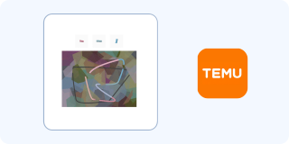

# Temu Captcha

**Complexity: ⭐⭐⭐⭐ (High)**

Temu uses a custom in-page CAPTCHA (not GeeTest or reCAPTCHA) with several rotating challenge types: slide puzzle, swap tiles, semantic click, arced slide, 3×3 grids, shapes/items and line-alignment. The pages are aggressively protected, so a clean browser fingerprint and residential IP matter as much as the puzzle itself.

#### How it looks:

#### Challenge types:
- **Slide** — drag a puzzle piece into the gap
- **Arced slide** — the piece travels an unpredictable arc; two possible targets
- **Puzzle slide** — pieces relocate after the drag starts
- **Swap** — two tiles are swapped; put them back
- **Semantic click** — "click the smaller green cylinders" and similar
- **Three-by-three** — select grid cells matching the instruction
- **Two image / line** — align lines or pick between two images

#### How to identify:
- Challenge rendered directly in the Temu page, often inside a modal
- Background image + one or more draggable pieces (transparent PNGs)
- Text instruction for click/selection tasks
- Aggressive anti-bot: fingerprinting, TLS checks, frequent re-challenges
- No sitekey/iframe pattern like reCAPTCHA or hCaptcha

#### How it works:
1. Temu serves the challenge to sessions it scores as risky.
2. The client sends the answer geometry (drag distance or click coordinates) to Temu's backend.
3. Temu validates it together with the session, IP and fingerprint.
4. A wrong or stale answer triggers another challenge, often a harder type.
5. Some types move the pieces after the drag begins, breaking naive "solve once, apply" pipelines.

---

### Free bypass methods

| Method | Description | Success Rate | Link |
|--------|-------------|--------------|------|
| **OpenCV** | 🔥 Gap/piece matching for slide and swap variants | 70-85% | [opencv/opencv-python](https://github.com/opencv/opencv-python) |
| **PuzzleSolver** | OpenCV-based slider pipeline | 70-85% | [vsmutok/Puzzle-Captcha-Solver](https://github.com/vsmutok/Puzzle-Captcha-Solver) |
| **DrissionPage** | Real Chromium; keeps the session and applies the drag | 65-85% | [g1879/DrissionPage](https://github.com/g1879/DrissionPage) |
| **Patchright / Camoufox** | Stealth browsers for Temu's fingerprinting | 60-80% | [Kaliiiiiiiiii-Vinyzu/patchright-python](https://github.com/Kaliiiiiiiiii-Vinyzu/patchright-python) |
| **ddddocr / YOLO** | Semantic click and grid challenges | 55-80% | [sml2h3/ddddocr](https://github.com/sml2h3/ddddocr) |
| **temu-captcha-solver** | Community solver for arced slide, swap, 3×3 etc. (uses a paid API) | high | [temu-captcha-solver](https://pypi.org/project/temu-captcha-solver/) |

### Practical approach
1. Use a residential IP and a stealth browser profile; Temu challenges datacenter traffic almost immediately.
2. Detect the variant from the DOM/instruction text before choosing a solver.
3. For slide: capture background + piece, match the gap, drag with a curved, human-like path.
4. For arced slide: the piece follows an arc — move the mouse along a curve and account for the two possible targets.
5. For semantic click/3×3: OCR the instruction and use object detection to find the targets.
6. Apply the answer in the same session and submit the result right away.

### Practical tips
- Temu's anti-bot is the hard part, not the puzzle: TLS fingerprint, headers and JS environment are all checked.
- Some challenges relocate pieces mid-drag — re-read the DOM after the drag starts if your first attempt fails.
- Don't brute-force: repeated failures escalate to harder challenge types.
- Keep cookies and the same IP from challenge to submission.
- Coordinates returned by image solvers are top-left corners; click centers (add half the piece size).

---

#### 💰 Paid alternatives:

| Service | Temu support | Notes |
|---------|--------------|-------|
| **2Captcha** | `TemuImageTask` | Send background + parts as base64; returns coordinates |
| **SadCaptcha** | Temu (via community wrappers) | Specialised Temu solver |
| **CapSolver** | Temu (check task list) | Availability varies |
| **Capzy / EveryInfra** | Temu image tasks | Alternative providers |

If free methods don't work, use API services: **2Captcha** or a specialised Temu solver. More details in the [Paid services](../solvers.md#paid-services-api) section.
